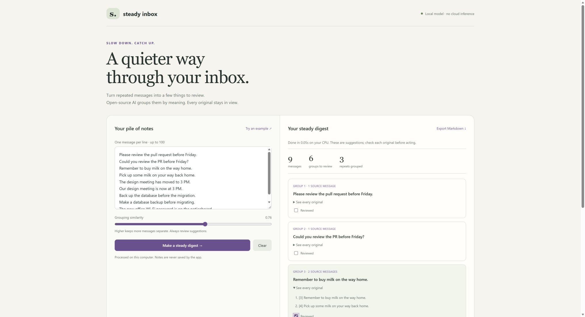
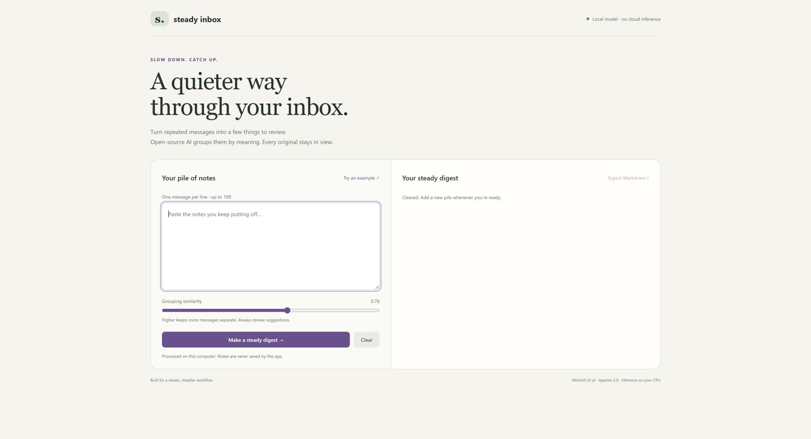

# Steady Inbox

A local tool for catching up on repeated messages. Paste notes, group them by semantic similarity, inspect every original, mark groups reviewed, and export a Markdown digest. No email or chat account access is needed.

Built for the Hacktoberfest 2026 Week 3 **Slow and Steady** theme during the challenge window. This is a new project, separate from the Kestra contribution.



The screenshot uses only the built-in synthetic example. The expanded group shows that original messages stay available rather than being replaced by a generated summary.

## Run on Windows

Python 3.12 **x64**, about 400 MB of free disk space, and an initial internet connection are required. Windows ARM64 was tested using x64 Python under emulation; native ARM Python with these dependency pins was not tested.

```powershell
py -3.12-64 -m venv .venv
.\.venv\Scripts\python.exe -m pip install -r requirements.lock
.\.venv\Scripts\python.exe setup_model.py
.\.venv\Scripts\python.exe app.py --port 8797
```

Open **http://127.0.0.1:8797/** in Edge. After setup, you can use `Start-SteadyInbox.ps1` to start the server. Press Ctrl+C in its terminal to stop it.

On Linux/macOS, use Python 3.12, `python -m venv .venv` and `.venv/bin/python`. `requirements.txt` pins the three direct dependencies; `requirements.lock` records the complete tested Windows environment. Platform-specific transitive dependencies in the lock may require using `requirements.txt` instead on other platforms. These platforms were not runtime-tested.

## How the open-source AI works

The Apache-2.0 [all-MiniLM-L6-v2 model](https://huggingface.co/sentence-transformers/all-MiniLM-L6-v2) produces token embeddings. The app applies attention-mask-aware mean pooling and L2 normalization to create 384-dimensional sentence embeddings using [ONNX Runtime](https://onnxruntime.ai/) and [Hugging Face Tokenizers](https://github.com/huggingface/tokenizers).

A conservative complete-link grouping rule requires **every pair** in a group to meet the selected cosine-similarity threshold. This avoids merging A and C merely because both resemble B. The representative is an existing source message, selected by average within-group similarity. No generative model invents summaries, actions, deadlines, or facts.

The model revision and file hashes are pinned in `model-manifest.json`. `setup_model.py` downloads only model data and verifies those hashes. Model files are excluded from Git. An initial download is required; inference itself makes no network requests.

## Privacy and limits

- The server binds to 127.0.0.1. Browser requests from other origins are rejected; the app has no telemetry or third-party scripts.
- Notes stay in browser memory and the local inference request. The app writes no notes or digests to disk automatically and keeps no message cache. Memory may still be managed by the OS, and the browser may retain form state; this is not a secure erasure tool.
- Export downloads a file only when you choose it. Clear removes the visible text and results. Closing the page and stopping the server ends the app session.
- Similarity is a suggestion, not a proof that two instructions are equivalent. Negations and changed dates can be easy to miss. Review every original before acting. Nothing is deleted, archived, or sent to anyone.
- Up to 100 messages, 1,500 characters each. The model uses the first 256 tokens of long messages; the UI warns about truncation and retains complete originals.
- English is the intended language of the model. No medical, legal, or safety-critical automation is performed.

## Tests and demo

```powershell
.\.venv\Scripts\python.exe -m unittest -v
node --check static\app.js
```

Tests cover actual model inference, semantic paraphrases, unrelated notes, source preservation, normalized vectors, truncation, input validation, and protection against chaining dissimilar notes. The included example is synthetic. Browser QA covers grouping, original expansion, reviewed state, invalid input, clearing, and Markdown export.

To reproduce the browser demo, start the service, choose **Try an example**, and choose **Make a steady digest**. The tested synthetic run displays 9 messages, 6 review groups, and 3 repeats grouped. Expand any multi-message group to inspect its complete originals.



Validation results and the submission draft live outside the source repository while publication is pending. This repository has not yet been published. A public demo/video and public code link must exist before a valid DEV entry can be submitted. Do not present a localhost link as a public deployment.

## Licenses and attribution

App code: MIT. Model weights and tokenizer: Apache-2.0, by the Sentence Transformers model authors; see `THIRD_PARTY_NOTICES.md`. The project uses AI assistance, with actual local inference and tests described transparently.

## Challenge submission status

Local preparation only; no DEV entry has been published. DEV Week 3 closes October 25, 2026 at 11:59 PM PDT (October 26, 2:59 AM Toronto). Confirm age/country eligibility and approve the final demo, code publication and article before submitting.

Any work committed after that deadline must be disclosed here before using the repository in a challenge entry.
